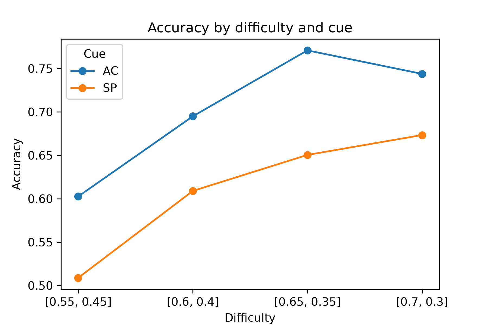
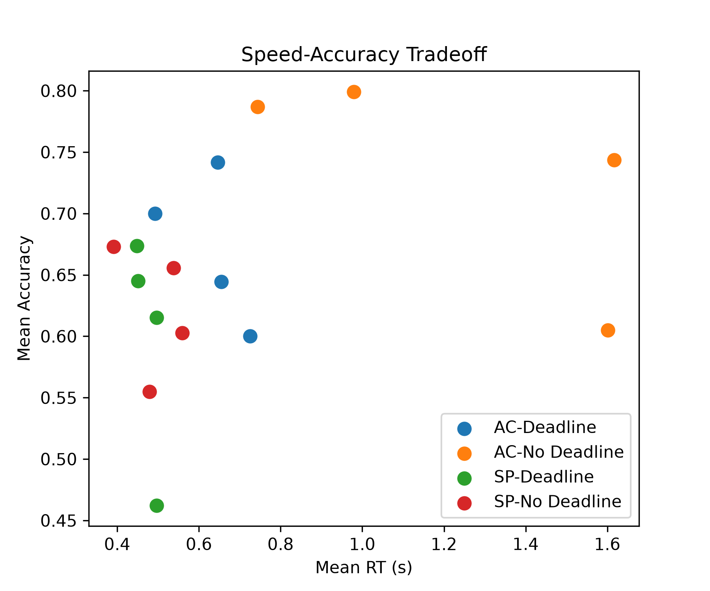
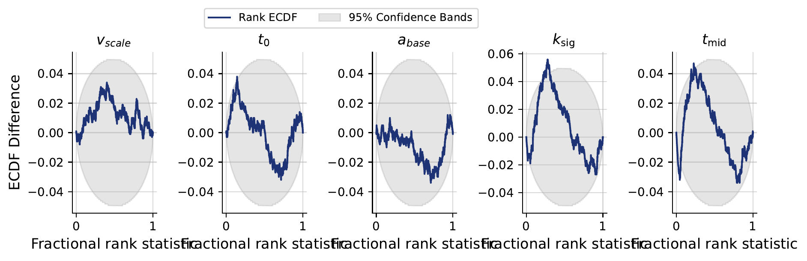

# Modeling Non-Linear Decision Boundaries in the Diffusion Decision Model


## Table of Contents

1. [Overview](#1-overview)
2. [Installation](#2-installation)
3. [Data](#3-data)
4. [Statistical Model](#4-statistical-model)
5. [Simulator](#5-simulator)
6. [Approximator & Training](#6-approximator--training)
7. [Diagnostics](#7-diagnostics)
8. [Inference](#8-inference)
9. [Discussion & Conclusion](#9-discussion--conclusion)
10. [Reproducing the Results](#10-reproducing-the-results)
11. [References](#11-references)

---

## 1. Overview

Evidence accumulation models (EAMs) such as the **Diffusion Decision Model (DDM)** explain speeded two-choice behavior as a noisy accumulation of evidence toward one of two decision boundaries.

Katsimpokis, Hawkins & van Maanen (2020) showed that different speed–accuracy trade-off (SAT) manipulations are best captured by different boundary *shapes*:

| SAT manipulation | Description | Best-fitting boundary (2020) |
|---|---|---|
| Speed instruction (SP) | Verbal emphasis on responding quickly | Fixed boundary |
| Response deadline | Hard computerised cutoff enforced | Linear collapsing boundary |

This implies the decision criterion changes dynamically *within* a trial, and that the exact shape of that dynamic matters.

### Research question

> **Do non-linear boundary functions (exponential and sigmoid) , improve model fit over linear collapsing boundaries?**

### Why simulation-based inference?

Once the boundary collapses non-linearly, the DDM likelihood is no longer available in closed form, so classical likelihood-based estimation is not straightforward. **Simulation-based inference (SBI)** sidesteps this: we generate a large number of $(\theta, x)$ pairs from the generative model and train a neural network to approximate the posterior $p(\theta \mid x)$ directly, which can then be queried instantly on real data. All SBI machinery comes from [**BayesFlow 2.0.12**](https://bayesflow.org/v2.0.12/index.html).

---

## 2. Installation

BayesFlow 2.x requires **Python 3.11–3.13**.

```bash
# macOS (Homebrew)
brew install python@3.13
/opt/homebrew/opt/python@3.13/bin/python3 -m venv .venv
source .venv/bin/activate

# Linux 
python3.13 -m venv .venv
source .venv/bin/activate

#windows
paula/esther
```

Install dependencies:

```bash
pip3 install --upgrade pip
pip3 install -r requirements.txt
```

`requirements.txt`:

```text
bayesflow==2.0.12
keras>=3.0
jax[cpu]         
tensorflow        
numpy
pandas
matplotlib
```


## 3. Data

The project relies on the **Flash-Pairs empirical dataset** from Katsimpokis et al. (2020).

On each trial participants perform a *flash task*: they identify which of two circles is flashing at the higher frequency. Difficulty is manipulated by varying the discrepancy between the two flash frequencies across **six levels**, ranging from hard (55 % / 45 %) to easy (80 % / 20 %).

Two orthogonal manipulations:

- **Cue** : *Speed instruction (SP)*: respond as fast as possible while staying reasonably accurate. *Accuracy instruction (AC)*: respond as accurately as possible.
- **Deadline** : the task was performed either under a hard deadline or with no deadline.

> **Subset used here:** only trials **with a deadline** and **under speed instruction** are included.

### Recorded variables

| Column | Meaning | Maps to in the DDM |
|---|---|---|
| `pp` | Participant ID | Individual differences in $v$, $t_0$, $a$ |
| `cue` | Speed (SP) / accuracy (AC) instruction | Boundary separation $a$ |
| `deadline` | Deadline / no deadline | Collapse rate ($\lambda$ / $k$ / $k_\text{sig}$) + hard cutoff time |
| `difficulty` | Categorical index (1–6) of the flash-rate discrepancy | Drift rate $v$ |
| `rt` | Response time (s) | Model output |
| `acc` | 1 = correct, 0 = error, NaN = non-response | Model output |

Marginal summaries:

| Variable | 0 | 1 |
|---|---|---|
| `deadline` | 0.496 | 0.504 |
| `cue` (0 = AC, 1 = SP) | 0.497 | 0.503 |

| Variable | min | mean | max |
|---|---|---|---|
| `rt` | 0.018 | 0.552 | 14.351 |

### Behavioural patterns

<table>
<tr>
<td width="50%">



*Accuracy as a function of difficulty across speed/deadline cues.*

</td>
<td width="50%">



*The speed–accuracy trade-off.*

</td>
</tr>
</table>

---

## 4. Statistical Model

### 4.1 Diffusion decision model

Evidence $X(t)$ accumulates according to the stochastic differential equation

$$dX(t) = v\,dt + \sigma\,dW(t)$$

- $v$ : drift rate, reflecting stimulus discriminability / task difficulty
- $\sigma$ : diffusion noise, fixed to 1
- $dW(t)$ : Wiener increment

A decision is made once $X(t)$ reaches $+B(t)$ (correct) or $-B(t)$ (error). The observed response time is $RT = t_0 + t^{*}$, where $t^{*}$ is the first-passage time and $t_0$ the non-decision time (encoding + motor execution). The starting point $z \in (0,1)$ allows an a-priori bias toward one boundary.

### 4.2 Boundary functions

The central manipulation of this project is the functional form of $B(t)$.

| Model | $B(t)$ | Shape parameters |
|---|---|---|
| **Fixed** | $a$ | — |
| **Linear** | $\max(a - k t,\ \varepsilon)$ | $k$ (collapse rate) |
| **Exponential** | $\max(a \cdot e^{-\lambda t},\ \varepsilon)$ | $\lambda$ (decay rate) |
| **Sigmoid (logistic)** | $\max\!\left(a\left(1 - \dfrac{1}{1+e^{-k_\text{sig}(t - t_\text{mid})}}\right),\ \varepsilon\right)$ | $k_\text{sig}$ (steepness), $t_\text{mid}$ (inflection time) |

All collapsing variants share an $\varepsilon$ floor (default `1e-4`) preventing $B(t)$ from reaching exactly zero, which would make the process terminate trivially. The exponential collapses fast early and asymptotes toward $\varepsilon$; the sigmoid stays near $a$ initially and then collapses sharply around $t_\text{mid}$.

### 4.3 Participant-level parameters and priors

| Parameter | Meaning | Prior |
|---|---|---|
| $v_\text{scale}$ | Scales difficulty into a drift rate ($v = v_\text{scale} \times \text{difficulty}$); the participant's overall sensitivity to the signal | $\mathcal{N}^{+}(1.25,\ 0.75)$ |
| $t_0$ | Non-decision time, the portion of RT not attributable to the decision process (encoding, motor execution) | $\mathcal{N}^{+}(0.19,\ 0.138)$ |
| $a_\text{base}$ | Baseline boundary separation before any condition-specific adjustment; the participant's default response caution | $\mathcal{U}(0,\ 1)$ |

$\mathcal{N}^{+}(\mu,\sigma)$ denotes a normal distribution truncated to $[0,\infty)$.

Condition-level parameters are **not** free priors of their own,  they are deterministic transformations of the participant-level draw.

### 4.4 Boundary-shape priors

| Boundary function | Parameter(s) | Meaning | Prior |
|---|---|---|---|
| Fixed | — | — | none (constant boundary $a_\text{base}$) |
| Exponential | $\lambda$ | Collapse rate | $\mathcal{N}^{+}(1.5,\ 1.0)$ |
| Sigmoid | $k_\text{sig}$, $t_\text{mid}$ | Steepness, halfway point | $\mathcal{N}^{+}(1.5,\ 1.0)$, $\mathcal{N}^{+}(0.5,\ 0.25)$ |

### 4.5 Fixed quantities

| Parameter | Value | Meaning |
|---|---|---|
| $z$ | 0.5 | Unbiased starting point, exactly midway between the boundaries |
| Noise SD ($\sigma$) | 1 | Standard deviation of the diffusion noise |
| $dt$ | 0.002 s | Time step used to discretize the diffusion process |
| $\varepsilon$ | 1e-4 | Lower floor on collapsing boundaries |

### 4.6 On the choice of the $t_0$ prior

An earlier specification used $t_0 \sim \mathcal{U}(0.5, 1)$ with hard bounds. Because the empirical data contain RTs well below 0.5 s, this floor propagated directly into the simulated RT distribution and produced a visible shift relative to the empirical histogram. It was replaced by a normal prior with mean 0.1 and SD 0.1, the mean chosen below the most frequent empirical RT, the SD wide enough to stay weakly informative. Since negative non-decision times are meaningless, the distribution is truncated to the positive range, which yields an effective mean of **0.191** and an effective SD of **0.138**, the values in the table above.

---

## 5. Simulator

For a given parameter vector $\theta$ and boundary function $B(t)$, trials are generated by discretizing the diffusion with the **Euler–Maruyama scheme**:

$$X_{t+dt} = X_t + v\,dt + \sigma\sqrt{dt}\,\epsilon_t, \qquad \epsilon_t \sim \mathcal{N}(0,1)$$

starting from $X_0 = (z - 0.5)\cdot 2a$.

**Per-trial procedure**

1. **Initialise** : clock at zero, evidence at $(z - 0.5)\times 2a$. With $z = 0.5$ this is 0.
2. **Step** : each `dt`, add drift × `dt` plus a standard normal draw scaled by $\sqrt{dt}$.
3. **Check boundaries** : if $X \ge +B(t)$ record `RT = t + t0`, `choice = correct`; if $X \le -B(t)$ record `RT = t + t0`, `choice = error`; if the deadline passes with no crossing, record a **non-response**.
4. **Repeat** across trials to produce a synthetic (RT, choice) dataset.

**Implementation notes**

- Integration is capped at a maximum duration, or at the empirical deadline in the deadline condition. Non-terminating trials are coded as non-responses, matching the censoring present in the empirical deadline condition.
- The simulator is **vectorized/batched**: it loops over time steps once and updates all trials in a condition cell simultaneously via boolean masks, scaled across participant × cue × deadline × difficulty combinations. This is what makes large training batches feasible.
- All four boundary functions are implemented behind a common interface.

> **Analogy:** a video game cannot run physics continuously, so it recalculates positions ~60 times per second. Here we recalculate ~500 times per second (`dt = 0.002 s`). Smaller `dt` means a more faithful approximation but more computation.


## 6. Approximator & Training

Networks are trained on simulated data to learn $p(\theta \mid x)$, using **BayesFlow 2.0.12**.

### Architecture

| Component | Choice |
|---|---|
| Summary network | `SetTransformer` |
| Inference network | `CouplingFlow`, 4 interleaved coupling layers |
| Activation | `SwiGLU` |
| Training mode | Online (simulate-on-the-fly) |
| Epochs | 30 |
| Batches per epoch | 32 |
| Batch size | 50 |

One network is trained per boundary model — **exponential** and **sigmoid**.

### Simplifying assumptions

- Observations are treated as **independent**.
- Individual differences between participants are **disregarded**.
- Repeated participation in the same task is not modelled, so **learning / practice effects across measurements are ignored**.
- No further covariates are incorporated, in order to keep results comparable to Experiments 2 and 3 of Katsimpokis et al. (2020).

---

## 7. Diagnostics

The exponential model is assessed in detail below; the corresponding figures for the sigmoid model live in the [Appendix](#appendix-sigmoid-model).

### 7.1 Convergence


*Diagnostic loss for the model trained with an exponential decision boundary.*

The loss curve indicates whether enough epochs were used: training is sufficient once the moving average of the training loss (grey) approaches the theoretical loss (blue). Here the two begin to converge from **epoch 21** and coincide by **epoch 30**, so 30 epochs is adequate.

### 7.2 Recovery


*Recovery of $v_\text{scale}$, $t_0$, $a_\text{base}$ and $\lambda$ under the exponential boundary model.*

Ground truth is on the x-axis and the posterior estimate on the y-axis; perfect recovery would fall on the diagonal.

- $v_\text{scale}$ and $t_0$ : the diagonal trend is largely present. **Good recovery.**
- $a_\text{base}$ :  close to the diagonal for small values, but above roughly 0.02 the estimates diverge, usually by **overestimating**; underestimation is rare, and estimates below 0.2 are unusual once the true value exceeds 0.02.
- $\lambda$ : estimates look **essentially random** with respect to the true value. **The collapse-rate parameter is not recoverable under the current setup**, which is the single most important caveat on the results below.

### 7.3 Calibration / coverage


*Simulation-based calibration: ECDF-difference plots for the exponential model.*

The x-axis is the fractional rank statistic, the normalised rank of the true parameter among draws from the estimated posterior. The y-axis is the difference between the empirical CDF of those ranks and the theoretical CDF of a uniform distribution; plotting the *difference* makes deviations easier to see than overlaying the two CDFs. The grey band is the 95 % confidence band; a difference of zero means empirical and theoretical CDFs coincide.

- $t_0$, $a_\text{base}$, $\lambda$ : the ECDF difference stays largely **within** the 95 % band.
- $t_0$ : predominantly positive, dipping slightly below zero near rank ≈ 0.95, and often riding the edge of the band, exceeding it only around rank ≈ 0.4.
- $a_\text{base}$ and $\lambda$ : mostly **below** zero, both reaching their minimum around rank ≈ 0.5.
- $v_\text{scale}$ : predominantly positive and **exceeding the upper bound** of the band across most of the range, returning inside it only near ranks 0 and 1. This is a genuine calibration problem.

**Verdict:** apart from $v_\text{scale}$, there is no strong evidence of substantial miscalibration. Proceeding to the empirical data is reasonable, with posterior predictive checks used as the follow-up validation.


*Posterior z-score vs. contraction for the exponential model.*

---

## 8. Inference

### 8.1 Fit to real data

The trained network is applied to the empirical data **per participant**. Posterior estimates for the exponential model are in `tables/param_estimates_exponential`; the sigmoid estimates are in `tables/param_estimates_sigmoid`.

### 8.2 Posterior predictive checks


*Posterior predictive checks for participants 2 and 7, as exemplary cases. All participants are shown in the Appendix.*


Both distributions are right-skewed with a maximum RT just under 4 s. The main discrepancy is at the lower tail, and it is a **prior artefact rather than a model failure**: the original $t_0 \sim \mathcal{U}(0.5, 1)$ prior imposed a hard floor on simulated RTs that the empirical data do not respect (see [§4.6](#46-on-the-choice-of-the-t_0-prior)).


Splitting by the type of time pressure confirms the pattern is not driven by the deadline manipulation: both panels reproduce the same structure as the pooled comparison, and in neither does the simulated histogram exceed the empirical one. The no-deadline group is the closer match, with its minimum sitting at the smallest admissible $t_0$.

### 8.3 Effect of the revised $t_0$ prior

After replacing the uniform $t_0$ prior with the truncated normal ($\mathcal{N}^{+}(0.191, 0.138)$), recovery and coverage diagnostics indicate the model retains its desired properties, so the revised specification is used for the subsequent analyses.


---

## 9. Discussion & Conclusion

- An **exponential collapsing boundary combined with a better-specified $t_0$ prior** is a viable model for these data; posterior predictive distributions track the empirical RT distribution reasonably well once the non-decision-time prior no longer imposes an artificial floor.
- The strongest caveat is that **$\lambda$ does not recover**. The parameter that carries the entire research question is the one the network cannot identify from the current summary statistics, so claims about the *shape* of collapse should be made cautiously.
- $v_\text{scale}$ shows a calibration problem in the SBC checks; its credible intervals should not be read at face value.
- A full **model comparison against fixed and linear boundaries** on the same footing remains the obvious next step. Without it, "exponential fits well" is not yet "exponential fits *better*."
- The model **ignores participant-level differences and cue effects**, and is trained on a subset of the data (deadline + speed instruction only). Adding hierarchical structure would allow the full dataset to be used and would likely improve identifiability of the shape parameters.

---

## 10. Reproducing the Results

```bash
source .venv/bin/activate

# 1. Sanity-check the simulator and produce the behavioural plots
python3 -m src.simulator --model exponential --plot

# 2. Train (online) — exponential and sigmoid
python3 -m src.train --model exponential --epochs 30 --batches-per-epoch 32 --batch-size 50
python3 -m src.train --model sigmoid     --epochs 30 --batches-per-epoch 32 --batch-size 50

# 3. Diagnostics: loss, recovery, SBC/coverage, z-score contraction
python3 -m src.diagnostics --model exponential --out images/

# 4. Fit to empirical data + posterior predictive checks
python3 -m src.inference --model exponential --data data/flash_pairs.csv --out images/
```

Trained approximators and posterior draws are cached with `pickle`; delete the cache to force a retrain.

---


## Appendix: Sigmoid Model


*Diagnostic loss for the model trained with a sigmoid decision boundary.*


*Recovery of $v_\text{scale}$, $t_0$, $a_\text{base}$, $k_\text{sig}$ and $t_\text{mid}$ under the sigmoid boundary model.*


*Simulation-based calibration for the sigmoid model.*


*Posterior predictive checks for every participant under the exponential decision boundary.*

---

## 11. References

- Katsimpokis, D., Hawkins, G. E., & van Maanen, L. (2020). *Not all speed-accuracy trade-off manipulations have the same psychological effect.* Computational Brain & Behavior.
- Ratcliff, R. (1978). *A theory of memory retrieval.* Psychological Review, 85(2), 59–108.
- Bogacz, R., Brown, E., Moehlis, J., Holmes, P., & Cohen, J. D. (2006). *The physics of optimal decision making.* Psychological Review, 113(4), 700–765.
- Voss, A., Rothermund, K., & Voss, J. (2004). *Interpreting the parameters of the diffusion model: An empirical validation.* Memory & Cognition, 32(7), 1206–1220.
- Hawkins, G. E., Forstmann, B. U., Wagenmakers, E.-J., Ratcliff, R., & Brown, S. D. (2015). *Revisiting the evidence for collapsing boundaries and urgency signals in perceptual decision-making.* Journal of Neuroscience, 35(6), 2476–2484.
- Higham, D. J. (2001). *An algorithmic introduction to numerical simulation of stochastic differential equations.* SIAM Review, 43(3), 525–546.
- Radev, S. T., et al. (2023). *BayesFlow: Amortized Bayesian workflows with neural networks.* Journal of Open Source Software. — [Docs](https://bayesflow.org/v2.0.12/index.html)

*Thank You! By [@dhakalmahima188](https://github.com/dhakalmahima188/) (Mahima Dhakal), [@paulalorr](https://github.com/paulalorr/) (Paula), [@bseskafle](https://github.com/bseskafle/) (Bishesh Kafle), and [@Es-T-H-er](https://github.com/Es-T-H-er/) (Esther)*
