# Modeling Non-Linear Decision Boundaries in the Diffusion Decision Model

## Table of Contents

- [Modeling Non-Linear Decision Boundaries in the Diffusion Decision Model](#modeling-non-linear-decision-boundaries-in-the-diffusion-decision-model)
  - [Table of Contents](#table-of-contents)
  - [Installation](#installation)
  - [1. Introduction](#1-introduction)
  - [2. Data](#2-data)
  - [3. Statistical model](#3-statistical-model)
    - [3.1 Diffusion decision model](#31-diffusion-decision-model)
    - [3.2 Boundary functions](#32-boundary-functions)
    - [3.3 Parameters and priors](#33-parameters-and-priors)
  - [4. Approximator](#4-approximator)
    - [4.1 Simulator](#41-simulator)
  - [5. Training](#5-training)
  - [6. Diagnostics](#6-diagnostics)
    - [6.1 Convergence](#61-convergence)
    - [6.2 Recovery rate](#62-recovery-rate)
    - [6.3 Coverage plots](#63-coverage-plots)
  - [7. Inference](#7-inference)
    - [7.1 Fit to real data](#71-fit-to-real-data)
    - [7.2 Posterior predictive checks](#72-posterior-predictive-checks)
  - [8. Discussion \& Conclusion](#8-discussion--conclusion)
  - [References](#references)
  - [9. Appendix](#9-appendix)

---

## Installation

BayesFlow 2.x requires **Python 3.11–3.13**.

```bash
# macOS (Homebrew)
brew install python@3.13
/opt/homebrew/opt/python@3.13/bin/python3 -m venv .venv
source .venv/bin/activate

# Linux
python3.13 -m venv .venv
source .venv/bin/activate

# Windows (PowerShell)
python -m venv .venv
.\.venv\Scripts\Activate.ps1
# ( Cant promise if the windows syntax works, please google !)
```

Install dependencies:

```bash
pip3 install --upgrade pip
pip3 install -r requirements.txt
```

`requirements.txt`:

```text
bayesflow==2.0.12
keras==3.15.0
jax==0.10.2
tensorflow==2.21.0
numpy==2.5.1
pandas==3.0.3
matplotlib==3.11.0
```

---

## 1. Introduction

Evidence accumulation models (EAMs) such as the diffusion decision model (DDM) explain speeded two-choice behavior as a noisy accumulation of evidence towards one of two decision boundaries.
Katsimpokis, Hawkins, and van Maanen (2020) [[1]](#ref-1) showed that different speed–accuracy trade-off (SAT) manipulations are best captured by different boundary shapes: a fixed boundary described data collected under verbal speed instructions well, whereas a linearly collapsing boundary was required to capture behavior under an enforced response deadline. This suggests that the decision criterion itself changes dynamically over the course of a trial, and that the exact shape of this dynamic matters.

The present project extends this line of work by asking whether non-linear boundary dynamics describe the data better than a simple linear collapse.
In the present case, an exponential and a sigmoid collapse are investigated.

The **Goal** of this project is to extend the modeling work of Katsimpokis et al. (2020) by implementing non-linear collapsing decision boundaries for the DDM, and by fitting these models within a simulation-based inference (SBI) framework using `BayesFlow`.
Because the likelihood of the DDM is analytically intractable once the boundary collapses in a non-linear fashion, classical likelihood-based estimation is not straightforward.
SBI solves this problem by learning the mapping from data to posterior directly from simulated data.

The **Research Question** can be described as:
Do non-linear boundary functions, here exponential and sigmoid, improve model fit over linear collapsing boundaries?

---

## 2. Data

<a id="sec-data"></a>

The project relies on the Flash-Pairs empirical dataset from [[1]](#ref-1).
On each trial, a "flash task" is performed.
Participants must identify which of two circles is flashing at a higher frequency.
The difficulty is adjusted by manipulating the discrepancy between both circles' frequencies across six distinct levels.
The difficulty levels range from a hard 55%–45% to an easy 80%–20%.

Speed–accuracy trade-offs are manipulated in two ways:
Speed instruction (SP) and Accuracy instruction (AC).
Under speed instruction, participants are instructed to respond as fast as possible while maintaining a reasonable level of accuracy.
Under accuracy instruction, they are instructed to respond as accurate as possible.

Furthermore, the task was either performed under a hard deadline or no deadline given.
For the purpose of this project, only observations with a given deadline and under speed instruction are included.


| | |
|---|---|
| 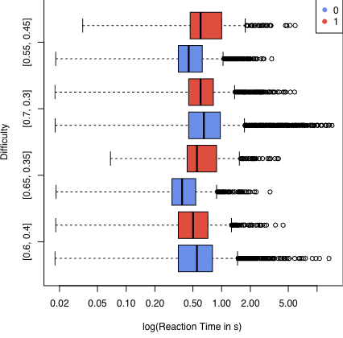 | 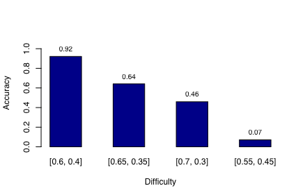 |
| *(a) RT with difficulty.* | *(b) Accuracy vs difficulty.* |


For each trial, the recorded variables are Difficulty, Choice and Response Time.
Difficulty represents the discrepancy in flashing rates, choice the judgment made by the participant (correct/incorrect), or missing if no response was made before the deadline.
Response Time describes the time elapsed from stimulus to response, when a valid response was made respectively.


---

## 3. Statistical model

<a id="sec-model"></a>

In this Section, the diffusion decision model, its boundary functions are explained together with all parameters and priors used for the further analysis.

### 3.1 Diffusion decision model

Single-trial choices and response times are modeled with a diffusion decision model (DDM in which noisy evidence accumulates over time toward one of two decision boundaries [[2]](#ref-2)[[3]](#ref-3).
Evidence $X(t)$ accumulates according to the stochastic differential equation

$$
dX(t) = v\,dt + \sigma\,dW(t),
$$

where $v$ is the drift rate, reflecting stimulus coherence/task difficulty, $\sigma$ is the diffusion noise, which is fixed to $1$, and $dW(t)$ is a Wiener increment.
A decision is made once $X(t)$ reaches one of two boundaries, $+B(t)$ (correct response) or $-B(t)$ (error response).
The observed response time is $RT = t_0 + t^{\ast}$, where $t^{\ast}$ is the first-passage time and $t_0$ is a non-decision time accounting for encoding and motor execution.
The starting point of accumulation, $z \in (0,1)$, allows for an a-priori bias towards one .
The different boundary functions are defined in the following section.

### 3.2 Boundary functions

<a id="subsec-model_boundary"></a>

The central manipulation in this project concerns the functional form of $B(t)$ [[4]](#ref-4)[[5]](#ref-5).

**Fixed boundary**

$$
B(t) = a.
$$

**Linear collapse**

$$
B(t) = \max(a - k\,t,\ \varepsilon),
$$

where $k$ is the collapse rate and $\varepsilon$ a small lower bound that prevents the boundary from reaching zero [[6]](#ref-6).

**Exponential collapse**

$$
B(t) = a \cdot \exp(-\lambda t),
$$

where $\lambda$ is the decay rate [[7]](#ref-7).
This function collapses exponentially towards zero.

**Sigmoid (logistic) collapse**

$$
B(t) = a \left(1 - \frac{1}{1+\exp(-k_{\text{sig}}(t-t_{\text{mid}}))}\right),
$$

with steepness $k_{\text{sig}}$ and inflection time $t_{\text{mid}}$ [[8]](#ref-8).
This function stays close to $a$ initially and collapses sharply around $t_{\text{mid}}$.

### 3.3 Parameters and priors

In the following subsection, all parameters and their priors are described. They can be grouped into participant-level parameters, condition-level and boundary shape parameters.

Participant-level parameters are fixed for each participant over all settings for difficulty and do not change for different decision boundaries. The priors were selected to be weakly informative but to include plausible ranges for the parameters of the diffusion-models. The positive-normal priors for $v_\text{scale}$ and $t_0$ ensure that the physiologically relevant positive range is sampled, and are able to vary considerably, while the uniform prior for $a_\text{base}$ assumes a lack of prior information and restricts the separation between the boundaries to a plausible range.

The condition-level parameters are not free priors on their own but are deterministic transformations of the participant-level draw.

The shape parameters of the specific boundary function are defined depending on which collapsing boundary model is active. The priors were chosen to provide weakly informative constraints while allowing flexibility in the shape and timing of boundary collapse. Positive-normal priors ensure meaningful positive values for the collapse rate and sigmoid steepness.

<a id="tab-part_lev_param"></a>

| Parameter | Meaning | Prior |
|---|---|---|
| $v_\text{scale}$ | Scales difficulty into a drift rate ($v = v_\text{scale} \times \text{difficulty}$); captures the participant's overall sensitivity to the motion signal | $\mathcal{N}^{+}(1.25,\, 0.75)$ |
| $t_0$ | Non-decision time i.e. the portion of RT not attributable to the decision process itself (encoding, motor execution) | $\mathcal{N}^{+}(0.19,\, 0.138)$ |
| $a_\text{base}$ | Baseline boundary separation, before any condition-specific adjustment; reflects the participant's default response caution [[9]](#ref-9) | $U(0, 1)$ |

*Participant-level parameters and their priors. $\mathcal{N}^{+}(\mu,\sigma)$ denotes a normal distribution with mean $\mu$ and standard deviation $\sigma$ truncated to $[0,\infty)$. $\mathcal{U}(0,1)$ denotes the uniform distribution in the interval $[0,1]$.*

Four parameters for the boundary functions are required.
Their definitions are listed as

| Boundary | Parameter(s) | Meaning | Prior |
|---|---|---|---|
| Fixed | --- | --- | none (constant boundary $a_\text{base}$) |
| Exponential | $\lambda$ | Collapse rate | $\mathcal{N}^{+}(1.5,\, 1.0)$ |
| Sigmoid | $k_\text{sig}$, $t_\text{mid}$ | Steepness, Halfway point | $\mathcal{N}^{+}(1.5,\, 1.0)$, $\mathcal{N}^{+}(0.5,\, 0.25)$ |

*Boundary-shape parameters and priors by collapsing-boundary model. $\mathcal{N}^{+}(\mu,\sigma)$ denotes a normal distribution with mean $\mu$ and standard deviation $\sigma$ truncated to $[0,\infty)$.*

Lastly, constant non-prior quantities are defined as
<a id="tab-fixed_param"></a>

| Parameter | Fixed value | Meaning |
|---|---|---|
| $z$ | $0.5$ | unbiased starting point, exactly midway between the two decision boundaries. |
| Noise SD | $0.1$ | standard deviation of the diffusion noise in the evidence-accumulation process. |
| $dt$ | $0.002$ s | time step used to discretize the diffusion process during simulation. |

*Fixed quantities used in the diffusion model.*

---

## 4. Approximator

<a id="sec-approximator"></a>

Because the likelihood of the DDM is not available in closed form once the boundary collapses non-linearly, we cannot fit these models by maximum likelihood.
Instead we use simulation-based inference (SBI): we generate a large number of $(\theta, x)$ pairs from the generative model described above and train a neural network to approximate the posterior $p(\theta \mid x)$ directly, so that it can later be queried instantly on real data.

### 4.1 Simulator

<a id="cap-Simulator"></a>

For a given parameter vector $\theta$ and boundary function $B(t)$, single trials are generated by discretizing the diffusion process with the Euler–Maruyama scheme [[10]](#ref-10) at a fixed time step $dt$ (e.g. $dt = 0.001$ s):

$$
X_{t+dt} = X_t + v\,dt + \sigma\sqrt{dt}\,\epsilon_t, \qquad \epsilon_t \sim \mathcal{N}(0,1),
$$

starting from $X_0 = (z-0.5)\cdot 2a$.
At every step the current evidence is compared against $\pm B(t)$ or, for the urgency model, against the fixed boundary after adding $u(t)$.
A trial terminates as soon as one boundary is crossed, yielding a response time and a choice.
Integration is capped at a maximum duration or, in the deadline condition, at the empirical deadline.
Trials that do not terminate in time are coded as non-responses, matching the censoring present in the empirical deadline condition.
The simulator is vectorized/batched over many trials and many prior draws so that large simulation batches can be produced efficiently for network training.

---

## 5. Training

The neural network is trained on simulated data, as described in [Section 4.1](#41-simulator), to learn the posterior distribution of the model parameters $\theta$ given the observed data.
Therefore, the analysis uses the Python package `bayesflow`, version 2.0.12 [[11]](#ref-11).

For this purpose, some simplifying assumptions are necessary. The observations are assumed to be independent, and individual differences between participants are disregarded.
In particular, the model does not account for repeated participation in the same test and, therefore, does not consider potential learning or practice effects across repeated measurements.
No additional factors that could influence these measures are incorporated, in order to maintain comparability with the original data from Experiments 2 and 3 reported by Katsimpokis, Hawkins, and van Maanen [[1]](#ref-1).

The neural network uses a `SetTransformer` as the summary network and a `Coupling Flow` with four coupling layers as the inference network.
The coupling layers are interleaved, and `SwiGLU` is used as the activation function.
The model is trained for 30 epochs, with 32 batches per epoch and a batch size of 50 in an online format.

The model is trained once for the exponential and once for sigmoid decision boundary as described in [Section 3.2](#32-boundary-functions).

---

## 6. Diagnostics

After training the model, its validity must be assessed.
In the following section, the validity of the model with an exponential decision boundary is assessed in detail.
The figures for assessing the validity of the model with a sigmoid decision boundary are available in the [Appendix](#9-appendix).
First, the convergence is checked with a diagnostics loss chart.
Afterwards, the recovery and coverage rates are visualized and assessed.

### 6.1 Convergence

The loss in regard to the amount of trainig epochs is shown in [the figure below](#fig-loss_exponential).
It is used to indicate whether a sufficient amount of epochs are used for the training.
The amount is enough when the moving average of the traing (grey) an the theoretical loss if the training (blue) approach. In this case it is given beginning with 21 epochs.
At the amount of 30 epochs they convert to each other. Therfore 30 epochs is a sufficient to proceed with the next steps.

<a id="fig-loss_exponential"></a>

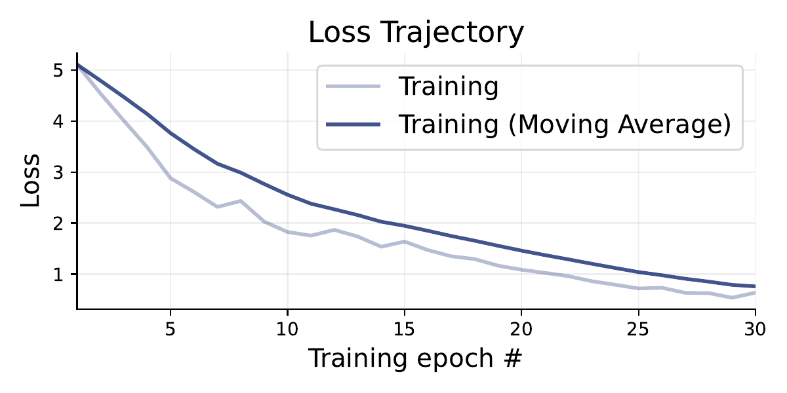

*Diagnostics Loss for model trained with exponential decision boundary.*

### 6.2 Recovery rate

The next step is to have a look at the recovery rate.
It serves as a measure of the extent to which the underlying decision boundary can be successfully restored after it has collapsed.
They show the ground truth on the x-axis and the estimated value on the y-axis this has the effect that ideally the values would be on the diagonal.
These are provided in [the figure below](#fig-recovery_exponential) for the parameters of the exponential decision boundary model: $v_{scale}$, $t_0$, $a_{base}$ and $\lambda$.
The diagonal trend is mostly given for $v_{scale}$ and $t_0$.
For small values of $a_{base}$ the estimated value is very equal as well but for values greater than 0.02 the prediction an Estimate differ. In this context, the value is often significantly overestimated and only rarely significantly underestimated. Estimates less than 0.2 are very unusual for true values greater than 0.02.
The estimater for $\lambda$ seems mostly random regardless the true value.

In the [recovery figure for the sigmoid model](#fig-recovery_sigmoid) in the Appendix, it is shown that the recovery rates for the sigmoid model is worse [[12]](#ref-12).

<a id="fig-recovery_exponential"></a>

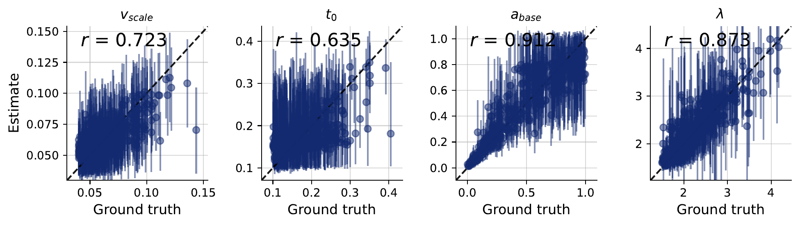

*Recovery rate of $v_\text{scale}$, $t_0$, $a_\text{base}$ and $\lambda$ for the exponential decision boundary model.*

### 6.3 Coverage plots

Before the trained neural network is applied to the empirical data, the performance and calibration must first be verified using simulated data. This is to ensure that the model can reliably reconstruct the underlying parameters and provide appropriate uncertainty intervals. To this end, coverage plots are used to verify whether the posterior confidence or credibility intervals achieve the expected coverage probabilities [[13]](#ref-13). For the parameter: $v_{scale}$, $t_0$, $a$ and $s_v$ is in [the figure below](#abb-coveragePlotAlt).

<a id="abb-coveragePlotAlt"></a>

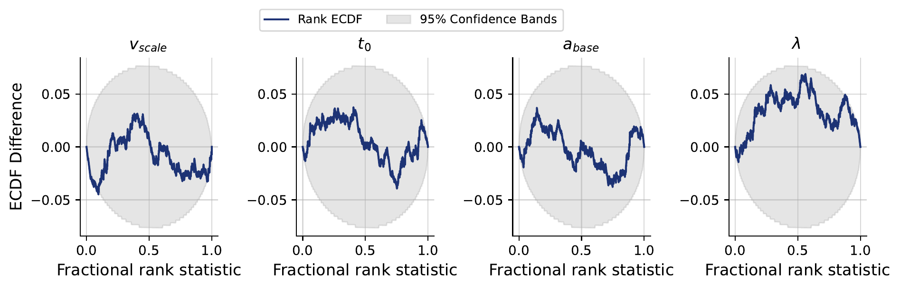

*Coverage plots for true and estimated parameters [[12]](#ref-12)*

The x-axis shows the fractional rank statistic, which represents the normalized rank of the true parameter relative to samples from the estimated posterior distribution. The y-axis shows the difference between the empirical cumulative distribution function (ECDF) of the observed functional ranks and the theoretical cumulative distribution function (TCDF) of the expected uniform distribution of ranks [[14]](#ref-14). The difference of these two are used because deviations are often easier to identify by subtracting the expected uniform behavior from the empirical cumulative distribution function [[15]](#ref-15).

The gray region represents the 95% confidence band, and the blue line represents the ECDF rank. A difference of zero indicates that the empirical and theoretical cumulative distribution functions coincide at that point [[16]](#ref-16) For the parameters $t_0$, and $a_{base}$ and $\lambda$, the ECDF difference remains largely within the 95% confidence band. The curves for $v_{scale}$ exceed the upper boundry whereas no curve falls below the lower boundry for a fractional rank statistic of nearly zero.

For $v_{scale}$, the ECDF difference remains predominantly positive. This indicates that the observed ECDF tends to lie above the expected uniform CDF. However, post parts of the curve remains within the 95% confidence band. The only time it is in this confidence band the fractional rank statistic is nearly zero ot nearly one. This suggests a possible calibration problem.

For $t_0$ the ECDF is positiv with a small exception around the fractional rank statstic of 0.95 where it is a little bit below zero. On the other hand it is often at the boarder of the 95% Confidence Band but only around the value of 0.4 above this.

The curve of $a_{base}$ is mostly under the value of zero as the curve for $\lambda$ as well. Both curves have their minimum around a fractional rank statistic of 0.5.

Overall, the results do not provide strong evidence of substatial miscalibration, except of $v_{scale}$, for the investigated parameters. It seems reasonable to apply the model to the empirical data and then verify it using posterior predictive checks.

After validation of the model, it can be used for inference.

---

## 7. Inference

In this Section, the model is fit to the empirical data described in [Section 2](#2-data). The results are further discussed using posterior predictive checks.

### 7.1 Fit to real data

As a first step the model is fit to the empirical data for each participant individually.
In the table below all posterior estimates for the exponential model are listed.

| Participant | `a_base` | `lam` | `t0` | `v_scale` |
|---|---|---|---|---|
| 0 | 0.11 [0.01, 0.35] | 2.44 [0.99, 4.22] | 0.49 [0.37, 0.60] | 1.13 [0.82, 1.52] |
| 1 | 0.13 [0.08, 0.22] | 1.50 [0.94, 2.15] | 0.29 [0.22, 0.34] | 1.12 [1.00, 1.24] |
| 2 | 0.04 [-0.05, 0.19] | 1.92 [0.46, 3.58] | 0.40 [0.29, 0.49] | 1.14 [0.73, 1.63] |
| 3 | 0.02 [-0.00, 0.03] | 1.86 [1.03, 2.85] | 0.26 [0.23, 0.28] | 1.06 [0.74, 1.41] |
| 4 | 0.02 [0.01, 0.04] | 1.28 [0.62, 1.94] | 0.09 [0.07, 0.11] | 1.31 [0.80, 1.86] |
| 5 | 0.07 [0.02, 0.13] | 1.49 [0.79, 2.29] | 0.27 [0.21, 0.33] | 1.09 [0.91, 1.29] |
| 6 | 0.02 [-0.00, 0.04] | 1.91 [0.97, 2.87] | 0.27 [0.25, 0.30] | 1.08 [0.79, 1.38] |
| 7 | 0.05 [0.03, 0.06] | 1.57 [1.06, 2.10] | 0.22 [0.20, 0.24] | 1.07 [0.93, 1.22] |
| 8 | 0.04 [0.02, 0.05] | 1.54 [0.97, 2.14] | 0.20 [0.18, 0.22] | 1.06 [0.87, 1.27] |
| 9 | 0.09 [0.07, 0.15] | 1.93 [1.31, 2.81] | 0.39 [0.34, 0.43] | 1.12 [1.02, 1.23] |
| 10 | 0.08 [-0.01, 0.30] | 2.30 [0.87, 4.18] | 0.48 [0.36, 0.57] | 1.12 [0.79, 1.50] |
| 11 | 0.09 [0.04, 0.18] | 1.86 [1.04, 2.84] | 0.36 [0.29, 0.42] | 1.10 [0.95, 1.26] |
| 12 | 0.09 [0.05, 0.14] | 1.77 [1.15, 2.56] | 0.35 [0.29, 0.39] | 1.11 [1.00, 1.23] |
| 13 | 0.03 [0.01, 0.06] | 1.91 [1.01, 3.07] | 0.35 [0.30, 0.39] | 1.10 [0.84, 1.36] |
| 14 | 0.09 [0.07, 0.12] | 1.29 [0.93, 1.66] | 0.17 [0.14, 0.20] | 1.08 [0.93, 1.24] |
| 15 | -0.00 [-0.03, 0.02] | 1.58 [0.42, 2.83] | 0.13 [0.11, 0.15] | 1.50 [0.57, 2.38] |
| 16 | 0.04 [0.02, 0.05] | 1.64 [0.99, 2.37] | 0.25 [0.22, 0.28] | 1.06 [0.87, 1.26] |
| 17 | 0.08 [0.04, 0.15] | 2.03 [1.09, 3.29] | 0.40 [0.33, 0.46] | 1.10 [0.94, 1.29] |
| 18 | 0.02 [-0.03, 0.09] | 1.97 [0.72, 3.49] | 0.39 [0.32, 0.46] | 1.13 [0.76, 1.52] |
| 19 | 0.19 [0.04, 0.55] | 2.15 [0.95, 3.55] | 0.43 [0.28, 0.54] | 1.10 [0.89, 1.33] |
| 20 | 0.07 [0.03, 0.12] | 1.78 [0.98, 2.78] | 0.35 [0.28, 0.40] | 1.10 [0.95, 1.29] |
| 21 | 0.01 [-0.01, 0.02] | 1.97 [0.97, 3.06] | 0.27 [0.24, 0.29] | 1.11 [0.69, 1.52] |
| 22 | 0.05 [0.02, 0.07] | 1.56 [0.95, 2.23] | 0.25 [0.22, 0.29] | 1.07 [0.90, 1.25] |
| 23 | 0.02 [0.01, 0.03] | 1.87 [1.05, 2.76] | 0.28 [0.26, 0.29] | 1.07 [0.83, 1.34] |

*Posterior estimates for each participant for the exponential decision boundary model.*

### 7.2 Posterior predictive checks

As a final step, posterior predictive checks (PPC) are performed to compare the differences between the predicted and actual data and to demonstrate how well or poorly the model performs.
[The figure below](#fig-ppc_exponential_2_7) compares a histogram of the empirical and simulated distributions for two exemplary participants.
The PPC for all participants are made available in [the Appendix](#fig-ppc_exponential_all).

<a id="fig-ppc_exponential_2_7"></a>

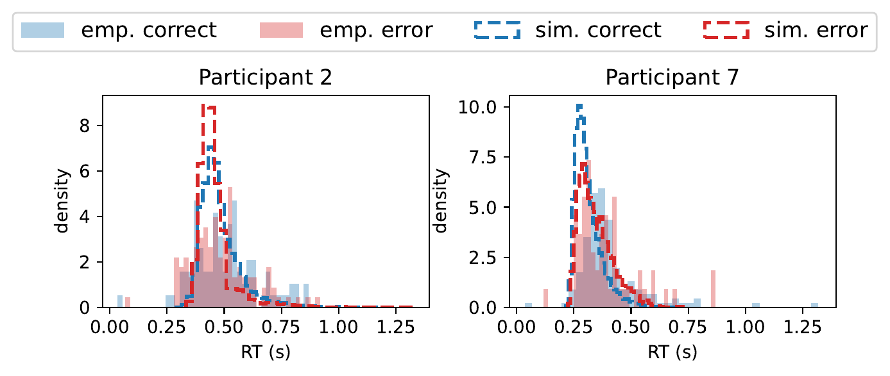

*Posterior predictive checks for participant 2 and 7 as examplary visualizations. Figures for all participants are made available in the [Appendix](#fig-ppc_exponential_all).*

Notably, the distributions of both participants are not equal.
Therefore, the PPC does not yield the same results for all participants.
Specifically, the results for participant two do not support the hypothesis of an underlying exponential decision boundary, whereas the fot for participant seven is more consistent with this hypothesis.

The PPC is also performed for the sigmoid decision boundary in [the figure below](#fig-ppc_sigmoid_2_7).

<a id="fig-ppc_sigmoid_2_7"></a>

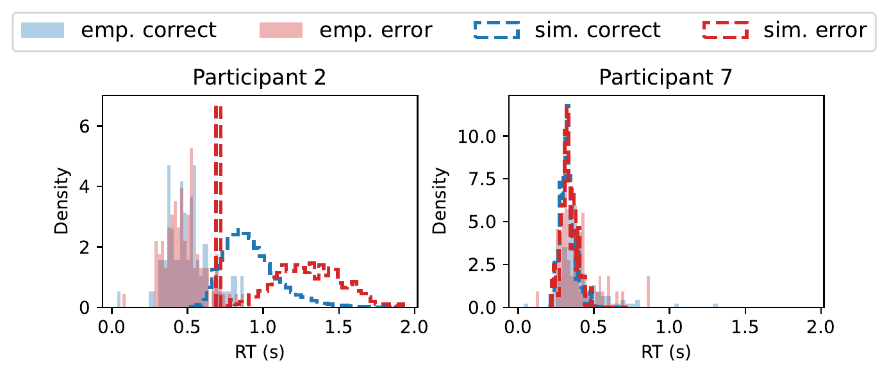

*Posterior predictive checks for participant 2 and 7 as exemplary visualizations. Figures for all participants are made available in the [Appendix](#fig-ppc_sigmoid_all).*

---

## 8. Discussion & Conclusion
Overall, this simulation study investigated how the collapse of decision boundaries can be modelled using two different functional forms: a sigmoid and an exponential function. The aim is to extend the approach of the original research. After building a model on simulated data in the same schema as the original data from the paper "Not all Speed-Accuracy Trade-Off Manipulations Have the Same Psychological Effect", this data is then used for posterior predictive checks to assess how well the model is able to reproduce the relevant characteristics of the simulated data. The analysis shows that, on average, the exponential function substantially outperformed the sigmoid function.

However, the drift rate $v_{\text{scale}}$ is not captured adequately by the model. In contrast, the other parameters are approximated well for both functions. In retrospect, the models can be improved by further optimising the priors chosen and increasing the number of batches per epoch and their size. Due to computational cost, this was not done here.

In further research, comparing the two functions with additional functions, such as the Weibull or the logarithmic function, could provide a broader range of possibilities for modelling collapsing decision boundaries. Such an exploratory analysis could help determine whether the observed differences between the sigmoid and exponential functions are specific to these two functional forms or reflect more general differences between classes of functions.

If the findings remain consistent across the functional forms, further research with more detailed data could be of interest. On the one hand, this could involve increasing the number of participants in the study. On the other hand, incorporating more individual information regarding the participants, like age, sex, or job title, could be valuable. Another possible approach to improving the models could be through including a learning effect into the data, which is already provided in the original analysis.

---

## References

1. <a id="ref-1"></a>Katsimpokis, D., Hawkins, G. E., & van Maanen, L. (2020). Not all Speed-Accuracy Trade-Off Manipulations Have the Same Psychological Effect. *Computational Brain & Behavior*, 3, 252–268. doi:[10.1007/s42113-020-00074-y](https://doi.org/10.1007/s42113-020-00074-y)
2. <a id="ref-2"></a>Ratcliff, R. (1978). A Theory of Memory Retrieval. *Psychological Review*, 85(2), 59–108. doi:[10.1037/0033-295X.85.2.59](https://doi.org/10.1037/0033-295X.85.2.59)
3. <a id="ref-3"></a>Bogacz, R., Brown, E., Moehlis, J., Holmes, P., & Cohen, J. D. (2006). The Physics of Optimal Decision Making: A Formal Analysis of Models of Performance in Two-Alternative Forced-Choice Tasks. *Psychological Review*, 113(4), 700–765. doi:[10.1037/0033-295X.113.4.700](https://doi.org/10.1037/0033-295X.113.4.700)
4. <a id="ref-4"></a>Hawkins, G. E., Forstmann, B. U., Wagenmakers, E.-J., Ratcliff, R., & Brown, S. D. (2015). Revisiting the Evidence for Collapsing Boundaries and Urgency Signals in Perceptual Decision-Making. *Journal of Neuroscience*, 35(6), 2476–2484. doi:[10.1523/JNEUROSCI.2410-14.2015](https://doi.org/10.1523/JNEUROSCI.2410-14.2015)
5. <a id="ref-5"></a>Voskuilen, C., Ratcliff, R., & Smith, P. L. (2016). Comparing Fixed and Collapsing Boundary Versions of the Diffusion Model. *Journal of Mathematical Psychology*, 73, 59–79. doi:[10.1016/j.jmp.2016.04.008](https://doi.org/10.1016/j.jmp.2016.04.008)
6. <a id="ref-6"></a>Srivastava, V., Feng, S. F., Cohen, J. D., Leonard, N. E., & Shenhav, A. (2017). A Martingale Analysis of First Passage Times of Time-Dependent Wiener Diffusion Models. *Journal of Mathematical Psychology*, 77, 94–110.
7. <a id="ref-7"></a>Milosavljevic, M., Malmaud, J., Huth, A., Koch, C., & Rangel, A. (2010). The Drift Diffusion Model Can Account for the Accuracy and Reaction Time of Value-Based Choices under High and Low Time Pressure. *Judgment and Decision Making*, 5(6), 437–449.
8. <a id="ref-8"></a>Zgonnikov, A. et al. (2023). A Cognitive Process Approach to Modeling Gap Acceptance in Overtaking. arXiv:2306.05203.
9. <a id="ref-9"></a>Voss, A., Rothermund, K., & Voss, J. (2004). Interpreting the Parameters of the Diffusion Model: An Empirical Validation. *Memory & Cognition*, 32(7), 1206–1220. doi:[10.3758/BF03196893](https://doi.org/10.3758/BF03196893)
10. <a id="ref-10"></a>Higham, D. J. (2001). An Algorithmic Introduction to Numerical Simulation of Stochastic Differential Equations. *SIAM Review*, 43(3), 525–546. doi:[10.1137/S0036144500378302](https://doi.org/10.1137/S0036144500378302)
11. <a id="ref-11"></a>Radev, S. T., Schmitt, M., Schumacher, L., Elsemüller, L., Pratz, V., Schälte, Y., Köthe, U., & Bürkner, P.-C. (2023). BayesFlow: Amortized Bayesian workflows with neural networks. *Journal of Open Source Software*, 8(89), 5702.
12. <a id="ref-12"></a>BayesFlow Developers (2026). *BayesFlow: Amortized Bayesian Inference — Documentation Version 2.0.12*. <https://bayesflow.org/v2.0.12/index.html> (accessed 2026-07-19).
13. <a id="ref-13"></a>Falkiewicz, M., Takeishi, N., Shekhzadeh, I., Wehenkel, A., Delaunoy, A., Louppe, G., & Kalousis, A. (2023). Calibrating Neural Simulation-Based Inference with Differentiable Coverage Probability. *Advances in Neural Information Processing Systems*, 36. doi:[10.52202/075280-0052](https://doi.org/10.52202/075280-0052)
14. <a id="ref-14"></a>D'Agostino, R. B. (1986). *Goodness-of-Fit Techniques*. Statistics: A Series of Textbooks and Monographs. Taylor & Francis.
15. <a id="ref-15"></a>Talts, S., Betancourt, M., Simpson, D., Vehtari, A., & Gelman, A. (2018). Validating Bayesian Inference Algorithms with Simulation-Based Calibration. arXiv:1804.06788. doi:[10.48550/arXiv.1804.06788](https://doi.org/10.48550/arXiv.1804.06788)
16. <a id="ref-16"></a>Conover, W. J. (1999). *Practical Nonparametric Statistics* (3rd ed.). New York: John Wiley & Sons.

---

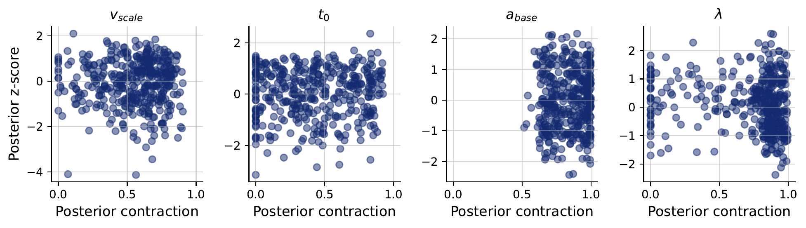

*Diagnostic z-score contraction*

---

## 9. Appendix

<a id="tab-posterior"></a>

*Relative frequencies of binary varibales of the data set, for _deadline_: "deadline" (1), "No Deadline" (0), _cue_: "AC" (0), "SP" (1)*

| Variable | 0 | 1 |
|---|---|---|
| *deadline* | 0.496 | 0.504 |
| *cue* | 0.497 | 0.503 |

*Non binary varibales of the data set*

| Variable | Meaning | min | mean | max |
|---|---|---|---|---|
| *rt* | Response Time | 0.018 | 0.552 | 14.351 |


<a id="fig-ppc_exponential_all"></a>

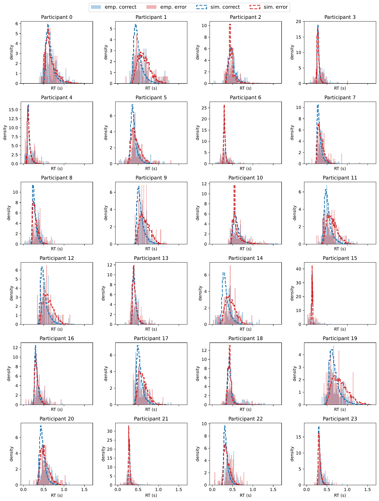

*Posterior predictive checks for each participant when simulating data with an exponential decision boundary.*

<a id="fig-loss_sigmoid"></a>

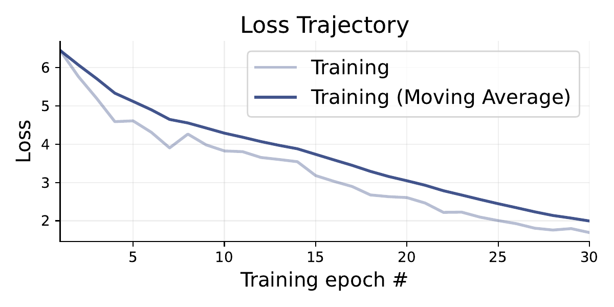

*Diagnostics Loss for model trained with sigmoid decision boundary.*

<a id="fig-recovery_sigmoid"></a>

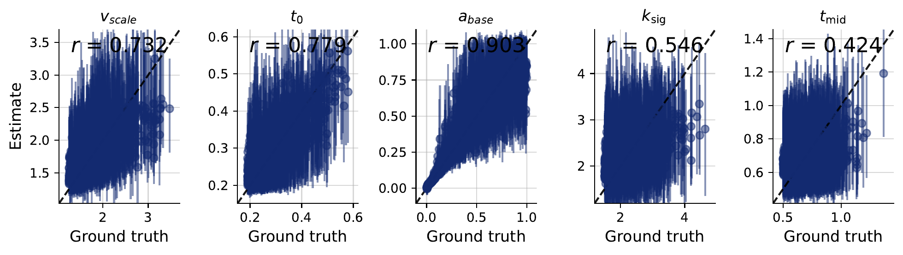

*Recovery rate of $v_\text{scale}$, $t_0$, $a_\text{base}$ and $\lambda$ for the sigmoid decision boundary model.*

<a id="fig-coverage_sigmoid"></a>

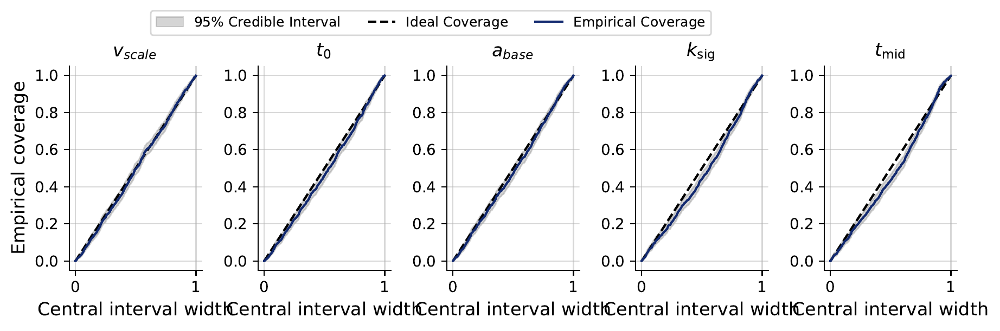

*Coverage plots for true and estimated parameters.*

<a id="fig-ppc_sigmoid_all"></a>

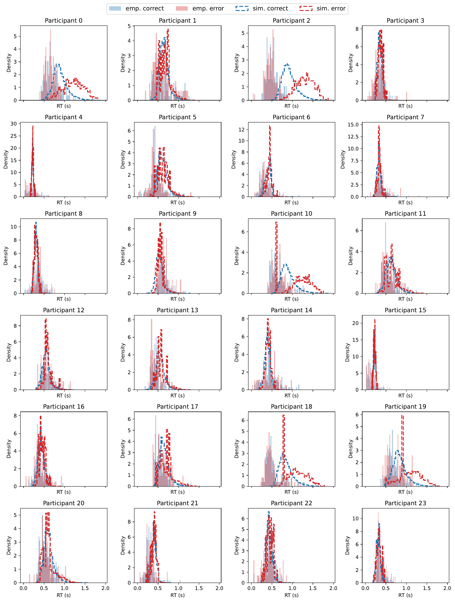

*Posterior predictive checks for every participant using sigmoid decision boundary model.*

---

*Thank You! By [@dhakalmahima188](https://github.com/dhakalmahima188/) (Mahima Dhakal), [@paulalorr](https://github.com/paulalorr/) (Paula), [@bseskafle](https://github.com/bseskafle/) (Bishesh Kafle), and [@Es-T-H-er](https://github.com/Es-T-H-er/) (Esther)*
